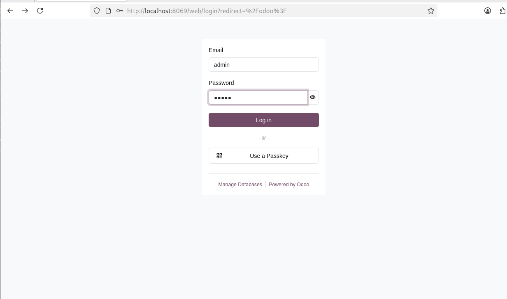
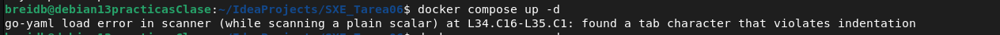
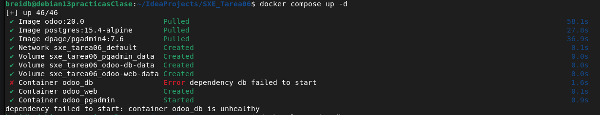
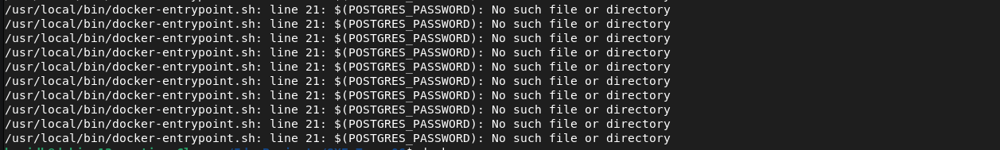
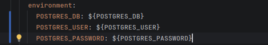
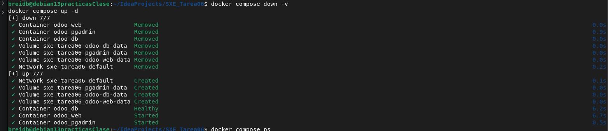

# Tarea 6 - Limpiezas Lagares

## Pasos para levantar el servicio

### 1. Crear el archvio de entorno real a partir de la plantilla
Crear el archivo .env a partir de la plantilla .env.example

````
cp .env.example .env
````

### 2. Levantar el servicio en segundo plano
Ejecucion del comando oficial de Docker Compose, con el parametro -d para ejecutar 
los contenedores en modo detached para liberar la terminal

````
docker compose up -d
````

## Verificar que todo está en ejecución

Para comprobar que la base de datos de PSQL y el contenedor de Odoo en pgAdmin se 
iniciaron correctamente y pasaron el "healthcheck"

````
docker compose ps
````

Y comprobar en la web que el servicio esta activo




## Incidencias

### Error al levantar el servicio
Al tener una linea indentada por tabulaciones, me salto el siguiente error



Como indica que lo tengo en la linea 34, intente corregirlo pero seguia dandome 
el mismo error asi que use el siguiente comando

````
sed -i 's/\t/  /g' compose.yaml
````
El cual se asegura de limpiar cualquier tabulación oculta en todo el archivo
de una sola vez.

### Error tras levantar el servicio



Al revisar el log de ese servicio en especifico 



Me di cuenta de que en mi compose.yaml escribi mal las variables, ya que llevan
llaves en lugar de parentesis



Despues de eso reinicie el servicio desde 0

````
docker compose down -v
docker compose up -d
````
y comprobe que los 3 contenedores estaban funcionando



### El servicio web no funcionaba


